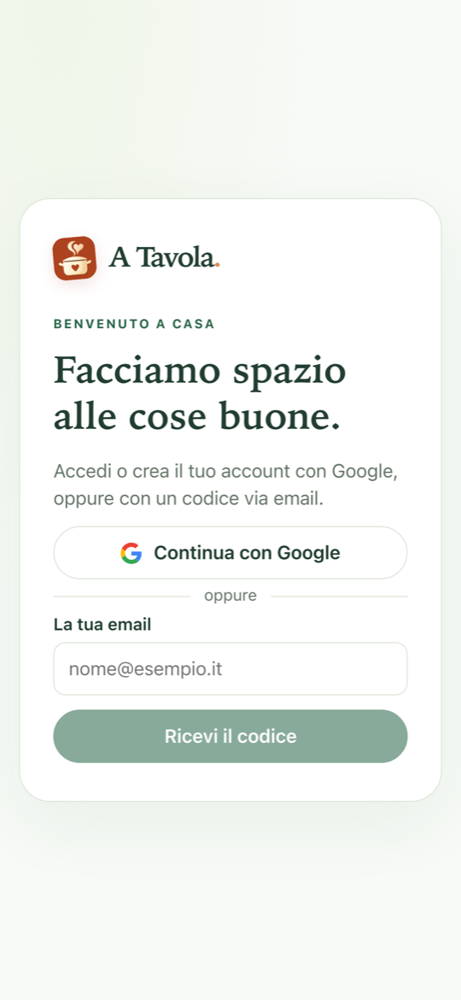
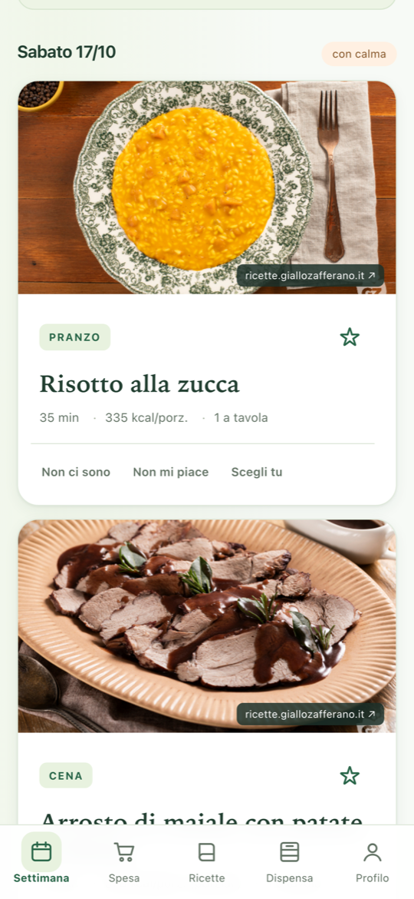
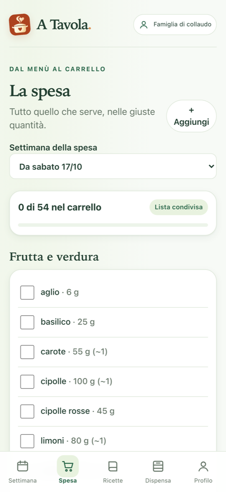
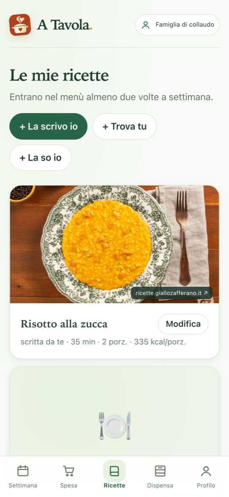

# A Tavola

**An AI meal planner for a person or a family.** It builds the week's menu around everyone's allergies and tastes, turns it into one shopping list and keeps track of what's left in the pantry.

Mobile-first PWA, in Italian. Live at [atavola.lorenzodambrosio.com](https://atavola.lorenzodambrosio.com) (sign-up is invite-only while in testing).

| Sign in | The week | Shopping list | Your recipes |
|---|---|---|---|
|  |  |  |  |

## What it does

- **Weekly menu with AI** (Claude, or Workers AI as a second provider). It respects the allergies and dietary rules of whoever is eating that day.
- **Allergies are checked in code, not trusted to the model.** Every AI answer is validated against the household's rules before it is saved. Meals the user pins are checked the same way.
- **"I don't like this" teaches it.** Rejected dishes are swapped and the preference is remembered per person.
- **Real recipes first.** Photos and steps come from the original recipe page, with ingredients scaled to the portions. AI only writes a recipe when none is found.
- **One shopping list** grouped by aisle and by when to buy. Ticks are shared between family members and refresh every few seconds.
- **Pantry that runs itself.** Confirmed purchases go into the pantry. A nightly job consumes them first-in, first-out, and it can't consume the same day twice.
- **Provider comparison for the admin**: same input to both models, with latency, tokens and rule violations side by side.

## Stack

| | |
|---|---|
| Backend | One Cloudflare Worker (Hono) serving the API and the static frontend |
| Frontend | React 19, Vite, TypeScript, installable PWA |
| Data | Cloudflare D1 (SQLite) with versioned SQL migrations |
| Auth | Better Auth: Google sign-in or a passwordless email code (Resend) |
| AI | Claude API (`@anthropic-ai/sdk`) and Workers AI behind one interface |
| Tests | Vitest on the real Worker runtime with local D1: 95 tests, no real AI calls |

```
src/domain/   pure logic: constraints, portions, nutrition, shopping, learning, pantry
src/server/   Hono worker: auth, routes, services, D1 queries, AI providers
src/web/      React frontend
migrations/   D1 schema + seed of ~300 ingredients and allergen groups
test/         domain and route tests
```

## How it was built

I designed the product and developed it with Claude Code: written spec first ([`docs/superpowers/specs`](docs/superpowers/specs)), then implementation phase by phase, each one closed by tests. Status and checks: [`docs/implementation-status.md`](docs/implementation-status.md).

## Run it locally

```bash
npm install
cp .dev.vars.example .dev.vars   # set BETTER_AUTH_SECRET and ANTHROPIC_API_KEY
npm run db:migrate:local
npm run dev                      # http://localhost:5173
```

In development the login code is printed in the terminal, so no email service is needed. Full setup and deploy guide (Italian): [`docs/setup.md`](docs/setup.md).
